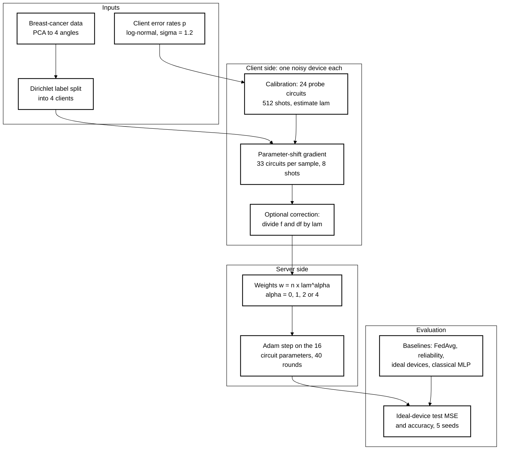
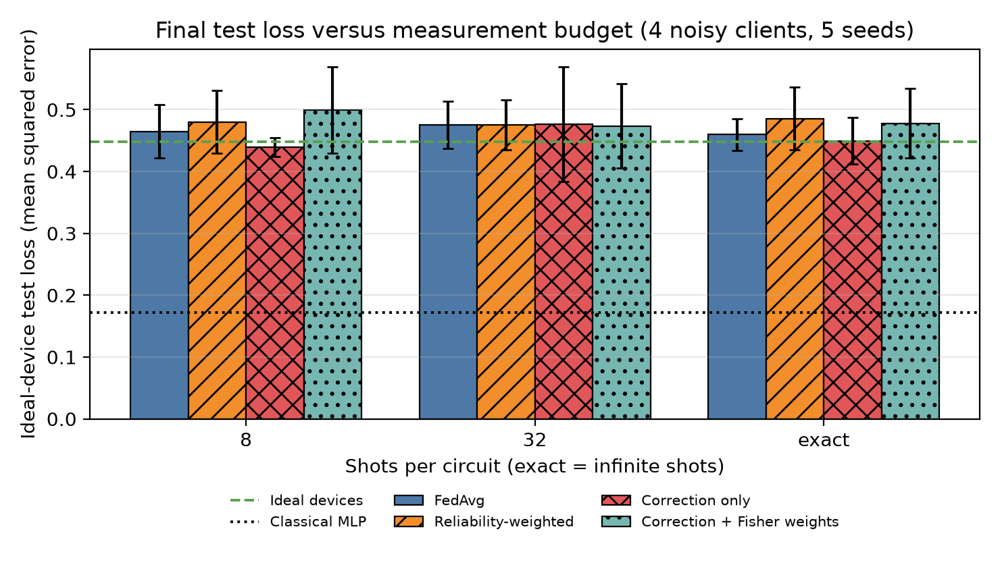
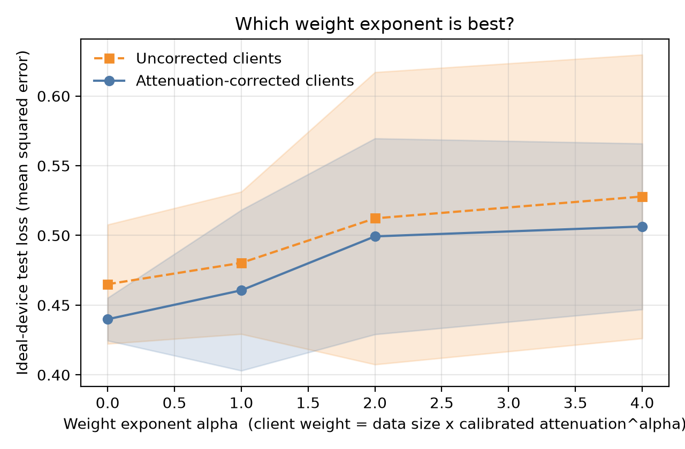
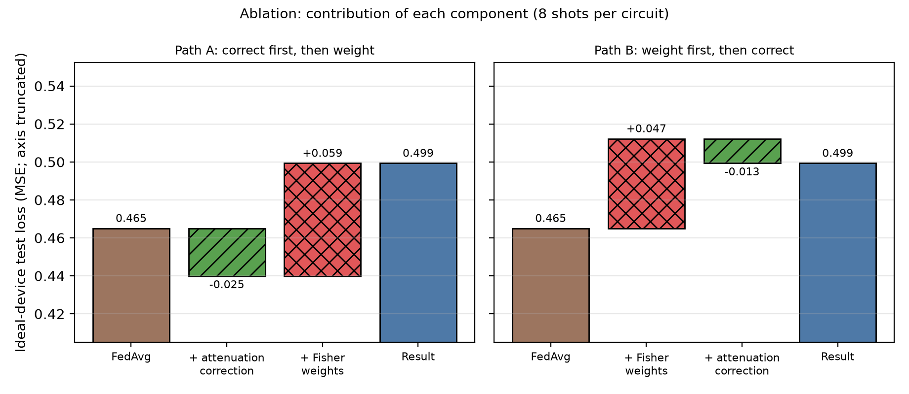
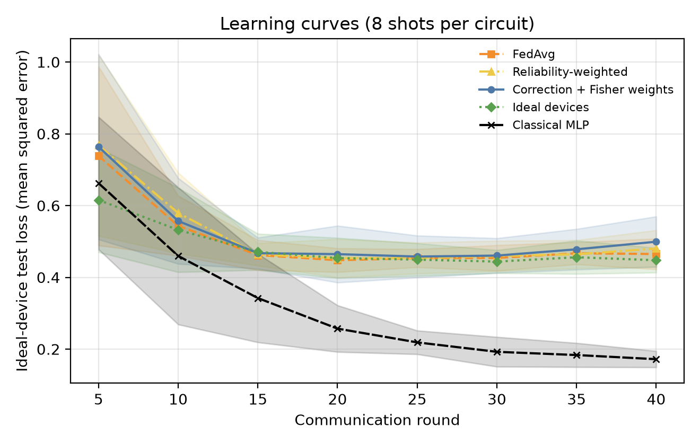
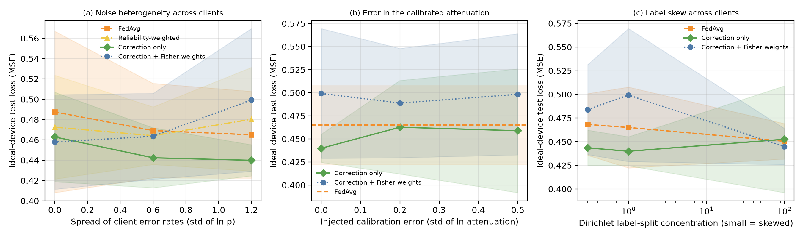

# Bias or Variance? Aggregating Gradients from Noisy Quantum Clients in Federated Variational Quantum Classifiers

[](LICENSE)
[](pyproject.toml)
[](https://github.com/pradeepdegalaroyal/noise-bias-vs-variance-federated-vqc-aggregation/actions/workflows/ci.yml)

**Abstract.** In a simulated federated learning (FL) setting, four clients each train a shared 4-qubit variational quantum circuit (VQC) classifier on their own noisy device with only a few shots per circuit. This project separates the two things that device noise does to a client's gradient: it *shrinks* the signal by a factor `lam < 1` (a bias, which a client can undo with a calibrated attenuation estimate whose shot cost is charged) and it *adds* shot variance (which the server can address with Fisher-information weights `lam^alpha`). Over 5 seeds, the correction alone lowers the ideal-device test mean squared error (MSE) from 0.465 ± 0.043 (federated averaging, FedAvg) to 0.440 ± 0.015 at 8 shots, a suggestive but not significant gain (4 of 5 seeds, paired t-test p = 0.12), whereas the Fisher weighting hypothesised to help further does not: it is worse than FedAvg in this setting (0.499 ± 0.070).

Abbreviations used throughout: variational quantum circuit (VQC), quantum federated learning (QFL), federated averaging (FedAvg), mean squared error (MSE), independent and identically distributed (IID), non-IID (not IID), quantum Fisher information (QFI), Noisy Intermediate-Scale Quantum (NISQ), principal component analysis (PCA), continuous integration (CI), controlled-Z gate (CZ), single-qubit Y and Z rotations (RY, RZ).

## Motivation

Federated learning lets several parties train one model without pooling data. If each party owns a small quantum device, the devices differ: gate errors, readout and coherence vary from device to device, and every expectation value comes from a finite number of shots. The aggregation step has to decide how much to trust each client. This matters on NISQ hardware, where a model trained across a fleet of unequal devices should not be dominated by the worst one, and it is the setting suggested by the heterogeneous quantum platforms surveyed in quantum magnonics (Yuan et al., 2022, doi:10.1016/j.physrep.2022.03.002).

## Research gap

* Youm (2027, doi:10.1016/j.future.2026.108886) builds a noise-aware QFL framework for Internet-of-Things edge devices with a reliability-weighted aggregation rule that down-weights noisier clients. It reports no uniform quantum advantage, a modest gain of 1.1 percentage points under shot-noise-limited training, and no gain with exact expectation values. The rule is a heuristic; the paper does not separate signal *bias* from shot *variance*, and does not test the rule against label skew between clients.
* Ibrahim et al. (2026, doi:10.1142/S0217732326502068) quantify estimation precision under decoherence through the QFI and the global quantum discord of a multipartite system. This motivates weighting by estimation precision, but their setting has no learning task and no multi-device aggregation.
* Yuan et al. (2022) review hybrid quantum platforms with very different coherence properties, the physical reason why client noise is heterogeneous.

Only these three papers were supplied for this study (no landmark paper), so the related-work table in [`docs/RESEARCH_GAP.md`](docs/RESEARCH_GAP.md) has three rows and makes no claim about the rest of the literature.

## What is new here

* A decomposition of device noise in federated gradients into **bias** (attenuation, removed by a client-side correction with a calibration whose shots are counted: 16.2 % of the shot budget at 8 shots) and **variance** (handled by a server-side weight `lam^alpha`).
* An ablation in both orders and an exponent sweep `alpha in {0, 1, 2, 4}` with and without correction, which isolates which of the two components does anything.
* A direct test of the inverse-variance (Fisher) weight against label skew between clients, noise heterogeneity, calibration error and a noise-model mismatch (amplitude damping).

## Hypotheses

* **H1 (bias).** At few shots and heterogeneous noise, attenuation-corrected clients with data-size weights beat FedAvg.
* **H2 (variance).** Adding the Fisher weight `lam^2` lowers the test MSE further.
* **H3 (null control).** With exact expectation values the aggregation rule hardly matters.

## Method



Legend: PCA = principal component analysis; MSE = mean squared error; FedAvg = federated averaging; MLP = multilayer perceptron (a 4-3-1 tanh network with 19 parameters); `f` = circuit output, `df` = its parameter-shift derivatives; `lam` = calibrated attenuation of a device; `n` = client data size.

The circuit encodes four features with RY rotations, applies two layers of RY, RZ and a CZ ring, and reads out the Pauli-Z expectation of qubit 0. Each client simulates its own depolarising channel after every gate with an exact density-matrix simulator (the ideal circuit is checked against a Qiskit statevector in the tests); the shot count is simulated by binomial sampling. The global model is scored with the **ideal** circuit. Full details are in [`docs/METHOD.md`](docs/METHOD.md). Aggregation rules compared:

| Rule | Client step | Weight |
|---|---|---|
| FedAvg (standard baseline) | raw noisy values | data size |
| Reliability-weighted (our implementation of the rule class in Youm, 2027) | raw | data size × `lam` |
| Correction only (H1) | divide by `lam` | data size |
| Fisher weights only | raw | data size × `lam^2` |
| Correction + Fisher weights (H1 + H2) | divide by `lam` | data size × `lam^2` |
| Ideal devices, exact gradients | none | data size |
| Classical MLP, 19 parameters | exact gradients | data size |

## Results

All numbers below are copied from [`results/tables.md`](results/tables.md), generated from `results/runs.csv`, `results/summary.csv` and `results/paired_tests.json`. Base operating point: 4 clients, 8 shots per circuit, median two-qubit error 0.08 with `sigma = 1.2` (mean true attenuation 0.612, mean worst-client attenuation 0.231), label-skew concentration 1, 40 rounds; mean ± sample standard deviation over seeds 0-4. Lower MSE is better.

| Method (8 shots) | Test MSE | Test accuracy | Δ MSE vs FedAvg (seeds improved, paired t p) |
|---|---|---|---|
| FedAvg | 0.465 ± 0.043 | 0.841 ± 0.052 | (reference) |
| Reliability-weighted (alpha = 1) | 0.480 ± 0.051 | 0.818 ± 0.056 | +0.015 (1/5, p = 0.47) |
| **Correction only** | **0.440 ± 0.015** | **0.889 ± 0.040** | **-0.025 (4/5, p = 0.12)** |
| Fisher weights only (alpha = 2) | 0.512 ± 0.105 | 0.828 ± 0.080 | +0.047 (1/5, p = 0.18) |
| Correction + Fisher weights (alpha = 2) | 0.499 ± 0.070 | 0.823 ± 0.059 | +0.034 (2/5, p = 0.19) |
| Ideal devices, exact gradients | 0.448 ± 0.034 | 0.855 ± 0.030 | -0.017 (3/5, p = 0.44) |
| Classical MLP (19 parameters) | 0.172 ± 0.023 | 0.945 ± 0.016 | -0.293 (5/5, p < 0.001) |



*Figure 1. At 8 shots the correction-only clients have the lowest quantum test loss; at 32 shots and with exact expectation values all rules lie within one standard deviation of each other.*

| Shots | FedAvg | Reliability | Correction only | Correction + Fisher |
|---|---|---|---|---|
| 8 | 0.465 ± 0.043 | 0.480 ± 0.051 | 0.440 ± 0.015 | 0.499 ± 0.070 |
| 32 | 0.476 ± 0.038 | 0.476 ± 0.041 | 0.477 ± 0.093 | 0.474 ± 0.068 |
| exact | 0.460 ± 0.026 | 0.486 ± 0.051 | 0.450 ± 0.037 | 0.478 ± 0.057 |



*Figure 2. Test loss grows with the weight exponent for both client types: the best exponent is 0 (plain data-size weights), not the inverse-variance value 2.*

Weight-exponent sweep (8 shots): uncorrected 0.465 ± 0.043 / 0.480 ± 0.051 / 0.512 ± 0.105 / 0.528 ± 0.102 and corrected 0.440 ± 0.015 / 0.461 ± 0.058 / 0.499 ± 0.070 / 0.506 ± 0.059 for alpha = 0 / 1 / 2 / 4.



*Figure 3. Correction removes 0.025 of test loss; the Fisher weight then adds 0.059 back (and 0.047 when applied first); the y-axis is truncated.*



*Figure 4. All quantum variants, including ideal devices with exact gradients, plateau near 0.45 after about 15 rounds, while the classical network keeps improving.*



*Figure 5. Correction-only stays at or below FedAvg across noise heterogeneity and calibration error (panels a, b); the Fisher-weighted variant is worse than FedAvg at sigma = 1.2 and under label skew, and on par or better only at lower heterogeneity and for IID labels.*

Robustness (test MSE, mean ± std over 5 seeds, 8 shots):

| Sweep | Setting | FedAvg | Correction only | Correction + Fisher |
|---|---|---|---|---|
| Noise spread sigma | 0 | 0.487 ± 0.079 | 0.463 ± 0.044 | 0.458 ± 0.046 |
| | 0.6 | 0.469 ± 0.046 | 0.442 ± 0.030 | 0.464 ± 0.042 |
| | 1.2 | 0.465 ± 0.043 | 0.440 ± 0.015 | 0.499 ± 0.070 |
| Label skew (Dirichlet beta) | 0.3 | 0.468 ± 0.033 | 0.443 ± 0.019 | 0.484 ± 0.048 |
| | 1 | 0.465 ± 0.043 | 0.440 ± 0.015 | 0.499 ± 0.070 |
| | 100 (IID) | 0.450 ± 0.019 | 0.453 ± 0.056 | 0.445 ± 0.019 |
| Calibration error (std of ln lam) | 0 | | 0.440 ± 0.015 | 0.499 ± 0.070 |
| | 0.2 | | 0.463 ± 0.051 | 0.489 ± 0.059 |
| | 0.5 | | 0.459 ± 0.067 | 0.498 ± 0.066 |
| Amplitude damping instead of depolarising | | 0.465 ± 0.034 | 0.516 ± 0.135 | 0.487 ± 0.108 |

## Discussion

* **H1 is weakly supported.** The correction gives the lowest MSE at 8 shots in the base setting and in the noise-spread sweep for sigma = 0.6 and 1.2, and it improves 4 of 5 seeds in each of those. With 5 seeds none of these paired differences reaches p < 0.05 (smallest p = 0.10 at sigma = 0.6), so this is a suggestive trend, not a demonstrated effect. The gain shrinks to +0.001 ± 0.067 at 32 shots, is lost under amplitude damping (+0.051 ± 0.107, where a single scalar attenuation is a poor description of the device), and is smaller than the seed-to-seed spread once the calibration is perturbed by 0.2 in ln lam (0.463 ± 0.051 versus 0.465 ± 0.043 for FedAvg).
* **H2 is not supported.** Test MSE increases with the weight exponent for corrected and uncorrected clients alike (Figure 2). Under label skew (beta = 0.3 and 1) the inverse-variance weight is worse than FedAvg, and at beta = 100 (IID) the three rules are indistinguishable (0.445 ± 0.019 versus 0.450 ± 0.019 for FedAvg; paired p = 0.48). A plausible reading, not tested here beyond this sweep, is that the weight discards the noisiest clients' data and with it the class information only they hold; the experiment shows that a weight chosen only from estimation variance can hurt, not why.
* **H3 holds.** With exact expectation values the paired differences against FedAvg are -0.010 ± 0.037 (correction only, p = 0.58) and +0.018 ± 0.044 (correction + Fisher), consistent with the exact-expectation observation in Youm (2027).
* **The reliability-weighted rule did not beat FedAvg here** (+0.015, 1 of 5 seeds improved at 8 shots). This is our own implementation of the rule class described in the abstract of Youm (2027), not a reproduction of that paper, on a different task, so it is not a refutation of their result.
* **Noise is not the bottleneck of this model.** Ideal devices with exact gradients reach 0.448 ± 0.034, about the same as the noisy clients, and the quantum model plateaus after about 15 rounds while the 19-parameter classical network reaches 0.172 ± 0.023. The dynamic range available to any aggregation rule is therefore small, which is why most differences are within one standard deviation. No quantum advantage is claimed or observed.

## Limitations

* Five seeds, four clients, one dataset, 4 qubits, 40 rounds, one gradient step per round: the paired tests have little power, and none of the reported differences is significant at the 5 % level.
* The calibration slope assumes a scalar attenuation; it costs 49 152 of 302 592 shots (16.2 %) per run at 8 shots, so the correction is not free, and the cost is already included in the totals of `results/runs.csv`.
* The classical network is a context line, not a tuned baseline, and the circuit is expressivity-limited rather than noise-limited at this size.
* Pilot runs (four to five seeds on the same data, using fewer settings) were used to choose the operating point (8 shots, median error 0.08, sigma 1.2), because at milder noise all rules were indistinguishable. The headline comparison is therefore at a deliberately noise-sensitive point.
* The label-skew sweep was added after the pilot hinted that the Fisher weight could fail under skew.
* Simulation only: no real-device data, no coherent errors, no readout error, no drift.

## Future work

* Replace the scalar attenuation by a per-observable damping estimate (for example from randomised or mirror circuits) so that the correction also covers amplitude damping and coherent errors.
* Weight by estimated gradient signal-to-noise per round rather than a fixed `lam^alpha`, and combine it with a data-coverage term so that label-holders are not discarded.
* Run multi-step local training, more clients and 6-10 qubits, where noise-induced gradient decay should make the weighting question matter more; then validate the calibration cost on a real device fleet.

## Reproducibility

```bash
pip install -r requirements.txt && pip install -e . --no-deps
pytest -q                                   # 13 tests, about 20 s
python experiments/run_all.py --quick       # smoke run, about 1 minute, writes to a temporary directory
python experiments/run_all.py               # full study: 195 unique runs, 5 seeds
python experiments/make_tables.py           # regenerates results/tables.md
```

Full study wall-clock: 418 s with 6 single-thread worker processes on a Windows 11 laptop (16 threads, shared with other work); the graphics card is not used. Seeds 0-4 fix data split, client noise levels, initial parameters, minibatches and shot sampling. Python 3.11.9, torch 2.11.0, Qiskit 2.4.2 (tests only). Raw per-run results: `results/runs.csv`, learning curves: `results/curves.csv`, summaries: `results/summary.csv`, `results/paired_tests.json`, run metadata: `results/meta.json`.

## Project structure

```
src/fisherfed/simulator.py   noisy density-matrix simulator, shot sampling
src/fisherfed/data.py        data, PCA encoding, Dirichlet client split
src/fisherfed/federated.py   calibration, parameter-shift client, aggregators, classical baseline
experiments/run_all.py       one-command study; plots.py figures; make_tables.py tables
tests/                       13 fast tests (simulator vs Qiskit, shift rule, pipeline)
docs/                        RESEARCH_GAP.md, METHOD.md
results/  figures/           raw results and the five figures
```

## Related work by the author

* [`shot-budget-nystrom-quantum-kernel-noise-floor`](https://github.com/pradeepdegalaroyal/shot-budget-nystrom-quantum-kernel-noise-floor): charging every shot in a quantum-kernel classifier under gate noise.
* [`label-scarce-fraud-qml-vs-classical`](https://github.com/pradeepdegalaroyal/label-scarce-fraud-qml-vs-classical): quantum models against tuned classical baselines with a noise sweep.

## Citation

```bibtex
@software{degala_noise_bias_variance_federated_vqc_2026,
  author  = {Degala, Chenchupradeep},
  title   = {Bias or Variance? Aggregating Gradients from Noisy Quantum Clients in Federated Variational Quantum Classifiers},
  year    = {2026},
  version = {0.1.0},
  url     = {https://github.com/pradeepdegalaroyal/noise-bias-vs-variance-federated-vqc-aggregation},
  license = {MIT}
}
```

MIT license (`LICENSE`). See also `CITATION.cff`.
